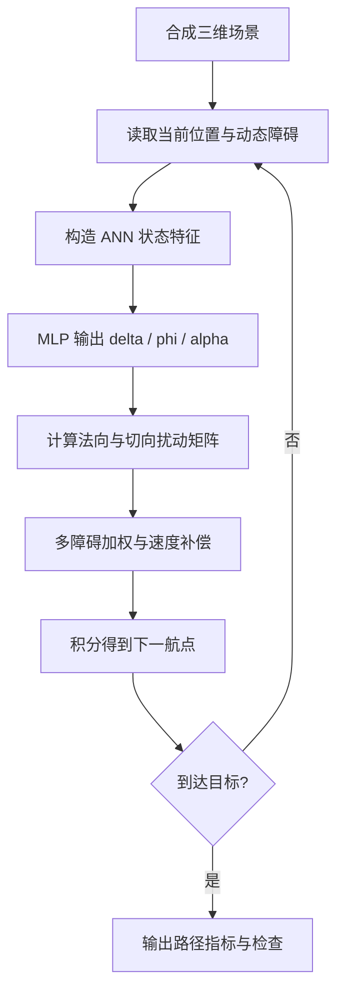

# 01 — IFDS–ANN 三维动态避障

来源 PDF：`3D real-time dynamic path planning for UAV based on improved interfered fluid dynamical system and artificial neural network.pdf`

这是论文算法的 **NumPy 核心重建，非完整复现**。它重建了球形障碍函数、IFDS 扰动矩阵、移动障碍速度补偿、MLP 前向推理和离散航迹积分；不包含论文未公开的训练样本、ESCSO 训练结果或原始网络权重。

## 从论文提取的执行步骤

1. 用论文式 (1) 的超二次曲面特例建立球形障碍函数 `F`。
2. 从当前位置到目标构造无障碍初始流速，对应式 (2)–(3)；实现采用指向目标的物理符号约定。
3. 根据相对目标、最近障碍净空和障碍速度构造 ANN 输入。
4. 以 ReLU 隐层和 tanh 输出层执行 MLP 前向计算，对应式 (14)–(16)。
5. 将网络输出映射为排斥系数 `delta`、切向系数 `phi` 和切向角 `alpha`。
6. 由障碍法向量和切向量构造 IFDS 扰动矩阵，对应式 (7)–(10)。
7. 对多个障碍加权合成扰动矩阵，并按式 (11)–(12)补偿移动障碍速度。
8. 按式 (13)积分到下一航点，重复至到达目标或达到步数上限。



## 重建假设

- 使用两个缓慢匀速移动的球形障碍和一个小型合成任务。
- 论文训练数据与 ESCSO 优化后的权重不可用，因此代码使用固定、可审计的微型 MLP 权重，仅重建“环境状态→IFDS 参数→流场更新”的在线链路。
- 多障碍权重使用 `1 / max(F-1, 0.05)` 归一化；碰撞边界只作数值安全投影。
- 目标方向采用 `goal - position`，避免 PDF 排版中式 (2) 的符号歧义。

## 运行

```bash
python3 run.py
```

标准输出只有一个 JSON 对象。`metrics` 给出航迹步数、长度、最终目标误差、最小动态净空以及 ANN 参数均值；`checks` 检查数值有限、无碰撞、到达目标和参数范围。固定种子为 `20240101`。
