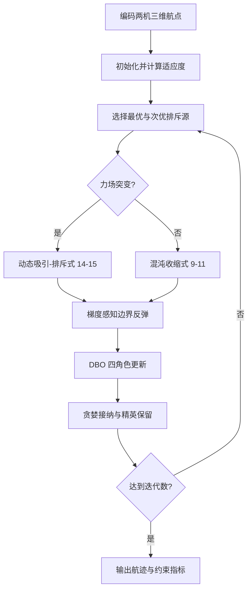

# 02 — ECFDBO 协同三维路径优化

来源 PDF：`A Novel Improved Dung Beetle Optimization Algorithm for.pdf`（论文题名为 *A Novel Improved Dung Beetle Optimization Algorithm for Collaborative 3D Path Planning of UAVs*）。

这是论文算法的 **NumPy 核心重建，非完整复现**。代码在一个两机、四中间航点的合成三维场景中执行 Environment-aware Chaotic Force-field Dung Beetle Optimizer（ECFDBO），不调用论文的 MATLAB/CEC2017 环境，也不声称复现论文表格。

## 从论文提取的执行步骤

1. 把两架 UAV 的中间航点编码为连续个体，计算长度、平滑度、障碍净空和同步时刻机间距。
2. 初始化种群并记录当前最优、全局最优和最差个体。
3. 取适应度前 10% 附近的次优个体作为排斥源。
4. 按论文式 (14)计算随迭代变化的吸引–排斥力场，并按式 (15)执行概率突变。
5. 其余个体按式 (9)–(11)执行混沌扰动与非线性收缩。
6. 越界坐标按式 (12)–(13)用有限差分梯度进行智能反弹。
7. 执行 DBO 的滚动、繁殖、觅食和偷窃四类角色更新。
8. 贪婪接纳并保留历史最优，迭代结束后解码协同航迹并检查约束。



## 重建假设

- 以球形障碍、相同时间索引的机间距离和固定起终点构造小型代理问题；球体净空与每个同步线性航段的机间距都用线段解析最小值计算，不依赖稀疏采样点。
- 论文的 PH/真实地形与 CEC2017 数据不在目录内，目标函数采用长度、最大单机长度、平滑度、净空和分离惩罚的透明组合。
- DBO 四角色保留论文行为分组，但步幅缩放到本合成空间；梯度反弹后再裁剪用于数值保护。
- DBO 的乘法局部边界在最优坐标为负时会交换数值顺序；实现先逐维排序两个端点，再与全局边界求交。
- 一个预置可行个体只用于确保合成测试含可行起点；后续仍由完整种群迭代。

## 运行

```bash
python3 run.py
```

标准输出为单个 JSON。`metrics` 包括初始/最终代价、路径长度、净空、机间距、力场突变数和边界反弹数；`checks` 检查有限值、精英不退化、边界、障碍、协同分离和端点。固定种子为 `20250202`。
