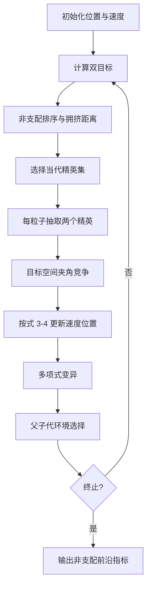

# 03 — CMOPSO 竞争式多目标粒子群

来源 PDF：`A competitive mechanism based multi-objective.pdf`（论文题名为 *A Competitive Mechanism Based Multi-objective Particle Swarm Optimizer with Fast Convergence*）。

这是论文算法的 **NumPy 核心重建，非完整复现**。实现使用论文实验中明确采用的 ZDT1 小实例，重点重建“当代精英选择→两两竞争→粒子学习→环境选择”，不依赖 PlatEMO，也不维护外部历史档案。

## 从论文提取的执行步骤

1. 在 `[0,1]^8` 初始化粒子位置与速度，并计算 ZDT1 的两个目标。
2. 对当前种群做非支配排序，再以拥挤距离选出 `gamma=10` 个精英粒子。
3. 每个待更新粒子从精英集中随机抽取两个竞争者。
4. 在归一化目标空间计算两个竞争者与当前粒子的夹角，较小夹角者获胜。
5. 按论文式 (3)执行 `v' = R1*v + R2*(winner-p)`。
6. 按式 (4)执行 `p' = p + v'`，并进行多项式变异。
7. 合并父代与子代，用非支配等级和拥挤距离保留固定规模种群。
8. 重复迭代，输出最终非支配前沿及其 IGD 近似值。



## 重建假设

- 采用 ZDT1 而非论文全部 21 个基准问题，以便十秒内完成可审计运行。
- 夹角在当代目标值的逐维归一化空间计算，原点取当代理想点。
- 论文框架的环境选择引用 SPEA2；本核心版使用正文同样明确采用的非支配排序和拥挤距离完成定长选择，避免引入外部库。
- 速度限制在 `[-0.25,0.25]`，变量投影到 `[0,1]`，属于小实例的数值保护。

## 运行

```bash
python3 run.py
```

stdout 只有一个 JSON 对象。`metrics` 包含初始/最终 IGD、非支配解数量、目标覆盖范围、间距、多项式变异数和竞争次数；`checks` 验证有限值、决策边界、前沿非空、IGD 不退化以及确实使用当代精英集。固定种子为 `20171003`。
