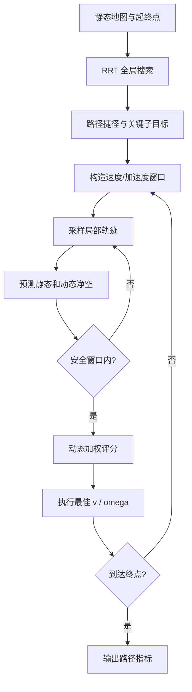

# 04 — RRT–DWA 动态环境混合规划

来源 PDF：`A hybrid RRT-DWA path planning .pdf`（论文题名为 *A hybrid RRT-DWA path planning framework for UAVs in dynamic environments*）。

这是论文算法的 **NumPy 核心重建，非完整复现**。它在二维合成场景中执行全局 RRT、关键子目标提取、速度窗口采样、动态障碍预测和局部 DWA 控制；不依赖论文的 ROS/Gazebo/MATLAB 项目，也不模拟真实飞控。

## 从论文提取的执行步骤

1. 在已知静态障碍地图上进行带目标偏置的 RRT 扩展，逐段碰撞检测并回溯全局路径。
2. 用可见性捷径删除冗余 RRT 节点。
3. 按论文式 (25)–(26)检查点间距离和转角，选取关键子目标。
4. 根据速度边界、加速度边界和当前速度构造动态窗口，对应式 (1)–(7)。
5. 对每个 `(v, omega)` 样本预测 1.5 秒局部轨迹，并预测移动障碍的位置，对应式 (18)–(20)。
6. 排除碰撞及不满足制动安全速度的轨迹。
7. 按目标距离、障碍净空和速度平滑度的动态权重评分，对应式 (11)–(17)。
8. 执行最佳控制量；到达当前子目标后切换下一个，直至目标或步数上限。



## 重建假设

- 使用二维圆形障碍和一个匀速移动障碍；论文最后提出的完整三维局部地图扩展不在本核心版范围内。
- RRT 采用目标偏置和固定步长；局部机器人使用平面单轮运动学。
- PDF 中部分评价式同时使用“cost”和“越大越好”的描述，本实现统一为最大化归一化评分，保留三项动态权重的相对作用。
- 传感器、ROS 话题、Gazebo 动力学和真实无人机延迟均未建模。

## 运行

```bash
python3 run.py
```

stdout 是单个 JSON。`metrics` 给出 RRT 节点/航点数、全局及实际路径长度、最小净空、最终误差、动态避障触发数和控制变化；`checks` 验证有限值、全局/局部无碰撞、到达目标与边界。固定种子为 `20260404`。
