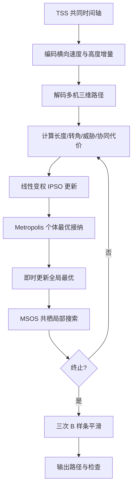

# 05 — HIPSO–MSOS 多机协同路径

来源 PDF：`A novel hybrid particle swarm optimization for multi-UAV cooperate path planning.pdf`

这是论文算法的 **NumPy 核心重建，非完整复现**。代码重建时间戳分段（TSS）、带 Metropolis 接纳的改进 PSO、即时全局最优更新、MSOS 共栖操作以及三次 B 样条平滑；场景缩小为两架 UAV 和一个球形障碍。

## 从论文提取的执行步骤

1. 给两架 UAV 使用相同起飞时刻、到达时刻与分段数，建立共同时间戳。
2. 将每段横向速度分量和高度增量编码为粒子，并积分成三维路径点。
3. 由路径长度、转角、飞行高度、障碍碰撞和同时间戳机间距构造代价。
4. 按论文式 (13)让惯性权重、认知系数递减，让社会系数递增。
5. 按标准 PSO 速度/位置式更新粒子，并用 Metropolis 准则更新个体最优。
6. 每处理一个粒子立即更新全局最优，使后续粒子使用最新信息。
7. 按论文式 (14)成对执行修改后的 SOS 共栖更新，只接纳更优后代。
8. 对最佳离散路径应用式 (15)–(16)的三次 B 样条并输出约束指标。



## 重建假设

- TSS 的纵向进度固定；横向速度积分后做线性端点校正，以确保精确抵达论文要求的目标点。
- 采用两机交叉任务、一个球形障碍和固定时间步；未使用论文的 jMonkeyEngine 地形、雷达和四机数据。
- PDF 中 Metropolis 指数的符号排版与最小化目标不一致，本实现使用常规 `exp(-(new-old)/T)`。
- B 样条端点以重复控制点固定；约束检查针对优化使用的原始航点密集插值，平滑长度作为补充指标。

## 运行

```bash
python3 run.py
```

stdout 为单个 JSON。`metrics` 包括初始/最终代价、共同到达时间、原始/平滑路径长度、转角、净空、机间距、海拔范围和两种接纳次数；`checks` 验证时间戳、端点及各约束。固定种子为 `20210305`。
