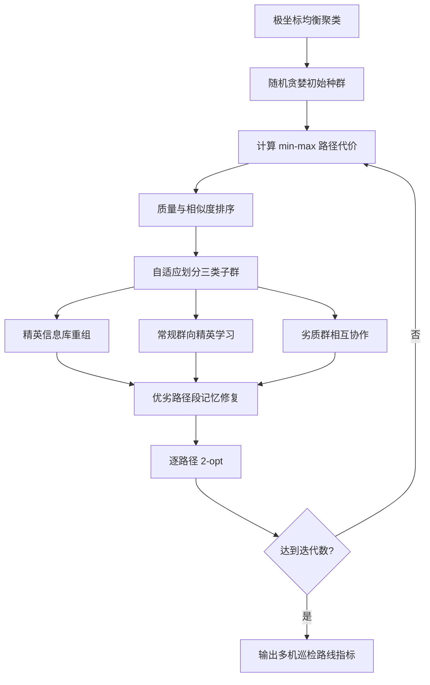

# 06 — Sa-VCO 协同巡检搜索

来源 PDF：`An adaptive heuristic algorithm with a collaborative search framework for .pdf`（论文题名为 *An adaptive heuristic algorithm with a collaborative search framework for multi-UAV inspection planning*）。

这是论文算法的 **NumPy 核心重建，非完整复现**。实现面向 15 个合成巡检点和 3 架同构 UAV，重建极坐标聚类、随机贪婪初始化、相似度/质量分群、精英信息库、均衡搜索、劣质群协作和 2-opt；不使用论文的 TSPLIB 数据与商业求解器。

## 从论文提取的执行步骤

1. 以基地为极点计算目标的距离和极角，按极角均衡聚类给各 UAV。
2. 在每一簇中建立最近候选集并随机选择下一目标，生成随机贪婪初始种群。
3. 用“最大单机路径为主、总路径为辅”的 min-max 目标评估个体。
4. 按式 (13)–(14)计算个体与当前最优解的路径段相似度。
5. 按适应度、相似度及式 (15)–(16)的自适应规模参数划分精英、常规和劣质子群。
6. 精英子群共享各访问路径的优秀信息；常规子群向随机精英学习，并建立优/劣路径段记忆。
7. 劣质子群彼此协作以扩大搜索域；所有后代经去重、补点修复和 2-opt。
8. 贪婪接纳改进解，循环后输出最均衡的完整多机路线。



## 重建假设

- 论文先进行区域网格化；本示例直接把网格中心视为 15 个标准子区域中心。
- 初始小规模 ACO 分支被随机贪婪分支替代，重点保留论文对大规模问题使用的低开销初始化逻辑。
- 个体以三条可变长目标序列表示；修复器保证每个目标恰好访问一次且每架 UAV 至少一个目标。
- 精英/常规的“优秀访问片段”用定向边频次表示；论文未给出的平局与拼接细节采用确定性最小增量插入。

## 运行

```bash
python3 run.py
```

stdout 仅含一个 JSON。`metrics` 给出初始/最终代价、最大/总路径、均衡标准差、各机长度、接纳后代数和精英库使用数；`checks` 验证数值、目标恰好访问一次、非空路线及不退化。固定种子为 `20250206`。
