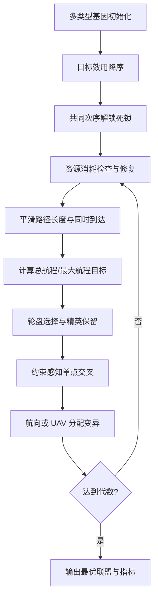

# 07 — 资源与同时到达约束协同 GA

来源 PDF：`Cooperative task allocation with simultaneous arrival and resource constraint for multi-UAV using a genetic algorithm.pdf`

这是论文算法的 **NumPy 核心重建，非完整复现**。实现包含“目标–UAV–到达航向”多类型基因、资源可行性修复、效用排序解锁、同时到达等待与定制交叉/变异；路径长度使用可审计的三次 Bézier 平滑代理，不是论文完整 PH 曲线/协同 PSO 规划器。

## 从论文提取的执行步骤

1. 将每个目标编码为最多三个基因；每个基因保存 UAV 编号和离散到达航向。
2. 按论文式 (19)计算“目标价值减距离代价”的期望效用，并按式 (20)得到全局目标执行次序。
3. 用该共同次序生成每架 UAV 的任务序列，使任务先后图为 DAG，从编码层消除等待死锁。
4. 按式 (12)–(13)逐目标贪婪分配 UAV 搭载资源，并修复不可行联盟。
5. 由起点、当前航向、目标和到达航向生成平滑曲线长度，计算式 (10)的总航程与最大单机航程组合目标。
6. 对同一目标的联盟成员取最晚到达时刻，给早到 UAV 增加等待，以满足同时到达。
7. 以倒数适应度轮盘选择父代，执行保持单目标 UAV 唯一性的单点交叉。
8. 随机执行航向变异或分配 UAV 变异，精英保留至终止。



## 重建假设

- 使用 5 架异构资源 UAV、3 个目标、2 类资源及 8 个离散航向的小型合成场景。
- 论文 PH 曲线生成还依赖其既有协同 PSO 工作；本版用起终航向约束的三次 Bézier 曲线近似边权，并明确不把它当作 PH 完整复现。
- 同时到达通过对联盟内较早成员加入等待实现；误差由各 UAV 的原始到达时刻加实际等待后重新计算，并按同步时刻尺度归一化，而不是从常量同步数组得到。未建模障碍、通信中断和飞行器损毁。
- 若交叉/变异无法经贪婪增加成员修复资源，使用已知可行联盟骨架保留其航向基因。

## 运行

```bash
python3 run.py
```

stdout 只有一个 JSON。`metrics` 给出代价、总/最大航程、任务完成时间、等待前最大到达时差、同步等待、同步后的绝对/相对到达误差及其时间尺度、联盟规模、资源余量、执行次序及遗传操作计数；`checks` 要求等待前确有非零到达时差并实际施加等待，再用各 UAV 的等待后到达时刻验证同时到达，同时检查有限值、资源、无重复分配、DAG 次序和联盟上限。固定种子为 `20240707`。
