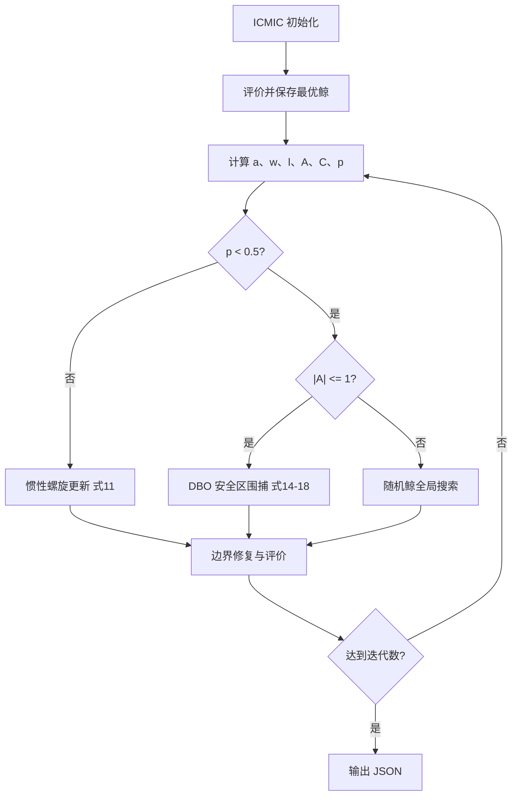

# 08 — DBO-AWOA

来源 PDF：DBO-AWOA An Adaptive Whale Optimization Algorithm for.pdf

这是依据论文公式与 Algorithm 1 编写的 NumPy核心重建非完整复现。它验证 ICMIC 初始化、非线性收敛因子、自适应惯性、DBO 生殖安全区与 WOA 三种搜索分支能组成可执行计算图；不复刻论文的 CEC2017 全套实验或三维无人机地图。

## 执行图提取

1. 用论文式 (8) 的 ICMIC 映射生成鲸群，并缩放到搜索边界。
2. 在小型移位 Ackley 合成函数上计算适应度，保存全局最优鲸。
3. 按式 (9) 计算余弦非线性收敛因子 a。
4. 按式 (10)、(12)–(13) 计算惯性权重 w 与螺旋参数 l。
5. 当 p < 0.5 且 |A| ≤ 1 时，按式 (14)–(18) 执行融合 DBO 生殖区的围捕更新。
6. 当 p < 0.5 且 |A| > 1 时，按 WOA 随机鲸搜索更新。
7. 当 p ≥ 0.5 时，按式 (11) 执行带自适应惯性的螺旋更新。
8. 截断越界坐标、重新评价，并以精英方式维护历史最优。



## 假设

- 使用 8 维移位 Ackley 函数代替论文的 CEC2017 与真实 UAV 地形，以便独立运行。
- 论文对向量 A 的分支判定在原 WOA 中按个体标量控制；本实现也为每个鲸生成一个标量 A。
- 所有候选点都按论文伪代码执行边界修复，历史最优仅用于报告和引导。

## 运行

```bash
python3 run.py
```

标准输出仅含一个 JSON 对象。metrics 给出初末最优值、到已知最优点的距离及三类更新次数；checks 验证有限数、精英轨迹单调、三分支均被执行以及最终种群未越界。
