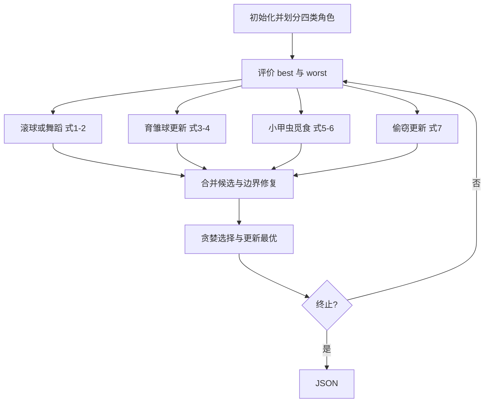

# 09 — Dung Beetle Optimizer

来源 PDF：Dung beetle optimizer a new meta-heuristic algorithm for global optimization.pdf

这是依据论文式 (1)–(7)、Algorithm 4 与 Remark 3 编写的 NumPy核心重建非完整复现。重点是把滚粪球、舞蹈、繁殖、觅食和偷窃四类行为逐步变成可执行数组运算，而不是复刻论文全部 23 个测试函数与统计检验。

## 执行图提取

1. 随机初始化 30 个候选解并计算合成多峰目标值。
2. 按论文 N=30 的示例把群体划为 6 个滚球者、6 个育雏球、7 个小甲虫和 11 个偷窃者。
3. 滚球者按式 (1) 利用历史位置与全局最差点移动，少量个体按式 (2) 舞蹈改向。
4. 按 R=1-t/T 和式 (3) 建立动态产卵边界，再按式 (4) 更新育雏球。
5. 围绕全局最佳点按式 (5) 建立觅食区，并按式 (6) 更新小甲虫。
6. 偷窃者按式 (7) 围绕局部最佳与全局最佳竞争食物。
7. 修复边界、贪婪保留更优候选并更新全局最佳。
8. 重复至终止并输出单个 JSON。



## 假设

- 用 6 维移位多峰平方函数提供已知最优点，代替论文的大规模基准套件。
- 采用 Remark 3 明示的 6/6/7/11 角色比例。
- 舞蹈角避开 0、π/2、π 的退化/奇异点；所有越界位置被截断。
- 因代理搜索域含负坐标，动态产卵区和觅食区先逐维排序两个乘法端点，避免负最优坐标令上下界反转。
- 为使小算例稳定可核验，对每个候选采用贪婪替换，同时仍按论文维护全局最佳。

## 运行

```bash
python3 run.py
```

metrics 报告优化前后目标值、到已知最优点的距离、角色数量和舞蹈次数；checks 验证有限数、角色总数、最优轨迹单调性及边界约束。
