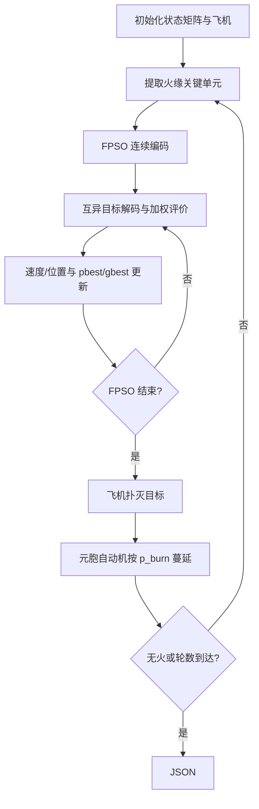

# 10 — Forest-fire rescue ensemble / FPSO

来源 PDF：Ensemble framework by using nature inspired algorithms for the early-stage forest fire rescue — A case study of dynamic optimization problems.pdf

这是依据论文式 (1)、(6)–(8)、规则 R1–R7 以及 Algorithms 1–8 编写的 NumPy核心重建非完整复现。它把动态火场模拟器、关键火点提取、FPSO 飞机分配和状态反馈闭合成一个离线循环；未使用论文的 300×300 地图、真实地理数据或 200 次大实验。

## 执行图提取

1. 建立含 S2 森林、S3 燃烧、S4 烧毁、S5 获救状态的 15×15 合成网格。
2. 从 S3 中提取邻接未燃森林的火缘关键单元，作为当期救援候选。
3. 将每架有水飞机的连续粒子坐标解码为互异的最近关键单元。
4. 按式 (1) 组合最大飞行时间与预计新增烧毁成本，并加入式 (13)–(15) 所述可达性、顺风火头和 3×3 连续燃烧加权。
5. 用惯性从 1 降到 0.2、c1=c2=2、速度上限 8 的 FPSO 更新任务分配。
6. 飞机扑灭目标单元；未获救 S3 按 R2 转为 S4。
7. 按式 (6)–(8) 计算植被密度与风向影响下的 p_burn，执行八邻域随机蔓延。
8. 将新状态矩阵和飞机位置反馈给下一轮，直到无火或达到小型终止轮数。



## 假设

- 地图、植被密度、风场和飞机初始位置均为固定种子的合成数据。
- 地形平坦，因此论文的坡度因子 ps=1；植被类型项 pveg=0。
- 每个模拟周期内飞机可到达所选火点，连续粒子坐标通过最近邻离散为论文的救援单元编码。
- 论文的消防加权选择公式在 PDF 中以算法图给出，本实现用其三个明确语义项构成同方向的确定性评分。

## 运行

```bash
python3 run.py
```

metrics 报告模拟轮数、各火场状态数量、飞机分配数和 FPSO 评分；checks 验证有限数、状态码、同轮目标唯一性和模拟器确实推进。
