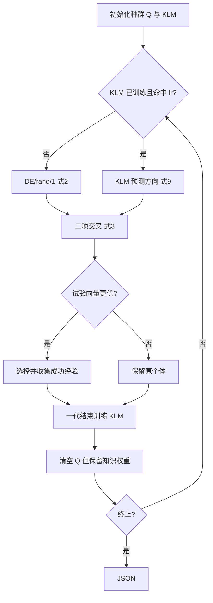

# 11 — Knowledge Learning for Evolutionary Computation

来源 PDF：Knowledge_Learning_for_Evolutionary_Computation.pdf

这是依据论文 Figure 2–4、式 (1)–(4)、(8)–(9) 与 Algorithm 1 编写的 NumPy核心重建非完整复现。论文给出 KLDE 和 KLPSO 两个实例；这里选择 KLDE，把“收集成功经验—训练知识库—按当前位置查询方向”的闭环完整落地，而不复刻 CEC2017 的 29 个函数和 51 次独立统计。

## 执行图提取

1. 初始化 DE 种群、空经验列表 Q，以及 D-16-16-D 的两隐藏层 KLM。
2. 对每个个体，以学习概率 lr 决定使用 KLM 或 DE/rand/1。
3. 未训练或未选中 KLM 时按式 (2) 生成差分向量；选中时由 KLM 预测方向并按式 (9) 作用于父代。
4. 按式 (3) 进行二项交叉，并至少保留一个变异维度。
5. 按式 (4) 选择；若试验向量更优，记录“旧位置、成功位移”到 Q。
6. 一代结束后，以位置为输入、成功位移为监督信号，用式 (8) 的 MSE 反向传播训练 KLM。
7. 清空 Q，但保留 KLM 参数，使其累计跨代知识。
8. 重复迭代并输出最优值、经验数、训练轮次与知识引导次数。



## 假设

- 采用论文明确给出的 KLDE 实例，目标为 6 维移位多峰函数。
- KLM 保持论文 Figure 3 的两个 16 节点 sigmoid 隐层和线性输出层，仅用 NumPy 手写全批量梯度下降。
- 位置和成功方向归一化后训练，以替代论文实验代码中的工程化训练细节。
- F、CR、lr 和训练 epoch 取适合小算例的固定值，目标是机制验证而非论文数值排名。

## 运行

```bash
python3 run.py
```

metrics 给出初末目标、到已知最优点的距离、成功经验数、KLM 训练及调用次数和末次 MSE；checks 检查有限数、知识确已学习和使用、最优轨迹及边界。
