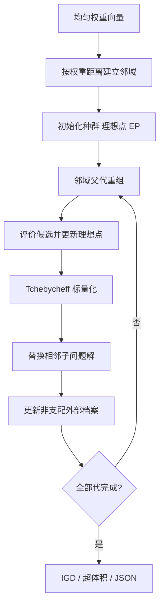

# 12 — MOEA/D

来源 PDF：MOEAD A Multiobjective Evolutionary Algorithm.pdf

这是依据论文 Section II–III、式 (3)、(6) 和 Step 1–3 编写的 NumPy核心重建非完整复现。它在小型 ZDT1 合成问题上验证“多目标问题分解为相邻标量子问题并共享候选”的核心，不复刻论文的全部连续/背包实验。

## 执行图提取

1. 均匀产生 41 个二维权重向量，每个权重对应一个标量子问题。
2. 计算权重间欧氏距离，为每个子问题选 7 个最近邻。
3. 初始化决策种群、目标向量、理想点 z 和非支配外部档案 EP。
4. 依次从当前子问题邻域选父代，以差分变异、二项交叉和小概率扰动产生候选。
5. 更新理想点 z。
6. 用式 (6) 的加权 Tchebycheff 值比较候选与每个邻居的当前解，较优则共享替换。
7. 删除 EP 中被新候选支配的点；若新候选不受支配则加入，并用拥挤距离限制容量。
8. 终止后以 IGD 与二维超体积描述对已知 Pareto 前沿的逼近。



## 假设

- 采用标准两目标 ZDT1 作为独立可计算问题，其真实前沿 f2=1-sqrt(f1) 可直接生成用于 IGD。
- 论文允许使用具体问题的遗传算子；这里采用邻域差分变异、二项交叉与高斯微扰。
- 零权重在 Tchebycheff 计算中用 1e-6 代替，避免端点子问题完全忽略某一目标。
- EP 上限为 100，超限时删除拥挤距离最小的内部点。

## 运行

```bash
python3 run.py
```

metrics 输出子问题/邻域规模、档案大小、初末 IGD、超体积、替换次数与理想点；checks 验证有限数、档案非支配性、理想点单调和决策边界。
