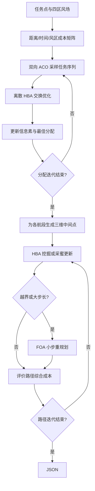

# 13 — BACOHBA + HBAFOA

来源 PDF：Multi-mechanism swarm optimization for multi-UAV task assignment and.pdf

这是依据论文式 (3)–(4)、(11)–(13)、(17)–(22)、(29)–(38) 及 Algorithms 1–2 编写的 NumPy核心重建非完整复现。它保留“先分配巡检任务，再规划每段航路”的两阶段结构，并同时执行双向蚁群—离散蜜獾与蜜獾—果蝇修复；不复刻论文的 eil76/rat575 数据和实测山地。

## 执行图提取

1. 建立 1 个基地、8 个巡检点和四区定常风场，按式 (3)–(4) 计算顺/逆风地速与时间。
2. 按式 (11)–(13) 合并距离、时间和跨风区代价，形成非对称任务边成本。
3. 双向蚁群分别按正向和反向边成本采样任务序列，并拆成两架 UAV 的路线。
4. 将任务排列间距离表示为交换算子序列，按式 (17)、(21)–(22) 的离散 HBA 思路向当前最优序列移动。
5. 以本轮最优结果蒸发/增强信息素，循环得到 BACOHBA 分配。
6. 为每条分配边生成三维中间航点，按式 (29)–(33) 评价距离、时间、能耗与高差，并沿中间点两侧的每个完整航段密集采样地形净空。
7. 按式 (34)–(37) 的强度、方向标志与密度因子执行 HBA 挖掘/采蜜更新。
8. 对越界或步长过大的航点按式 (38) 进行 FOA 小步重规划，保留更优路径。



## 假设

- 使用 8 个合成巡检点、2 架同构 UAV 和归一化四区风速，保证 CPU 上快速执行。
- 任务排列按相等长度拆给两架 UAV；所有任务恰好出现一次并回到共同基地。
- 论文连续 HBA 的强度项做数值截断，避免小型离散实验中的除零爆炸。
- 式 (38) 的 FOA 扰动对方向作对称化，使越界航点可向任一方向回到可行域。
- 合成山峰由光滑高度函数表示；每段含端点在内按水平间距不超过 `0.01` 动态均匀采样，净空定义为“航迹高度 − 地形高度 − 0.08 安全裕度”，负净空按穿透深度和违规采样比例加入有限罚值。
- 初始种群显式包含一条中间航点高度为 `0.55` 的可审计安全路线，确保小型固定种子实验包含可行候选；该候选与其余个体使用完全相同的成本和净空评价。

## 运行

```bash
python3 run.py
```

metrics 分别报告任务分配与航路规划的初末成本、直线基线及最终航迹的最小地形净空、最大净空采样间距、FOA 重规划次数和风区数；checks 使用最终航迹全部密集采样点的真实最小净空验证安全裕度，并检查数值有限、任务唯一分配、分配不劣于基线及 FOA 分支确已执行。
