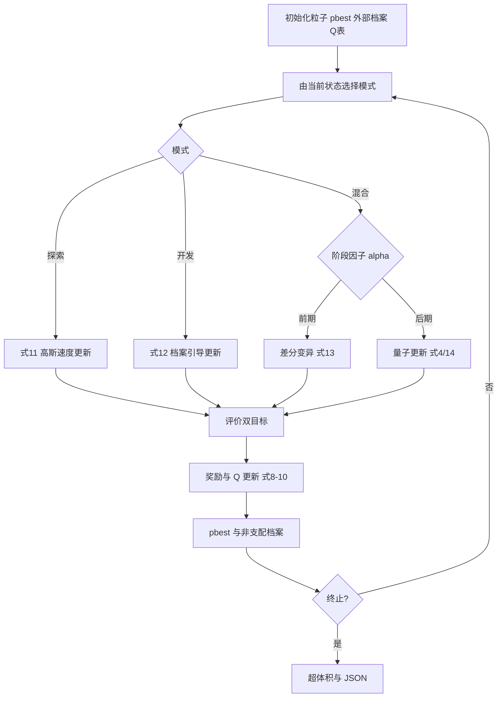

# 14 — MCMOPSO-RL

来源 PDF：Multi-objective particle swarm optimization with multi-mode.pdf

这是依据论文式 (2)–(15)、外部档案流程 Figure 4 和路径目标式 (16) 起的 NumPy核心重建非完整复现。它实现每粒子独立 Q 表、探索/开发/混合三模式、量子与差分更新及非支配档案；未复刻原始三维地形、B 样条和完整 UAV 约束集。

## 执行图提取

1. 将 6 个固定横坐标的纵坐标编码为 UAV 中间航点，并计算路径长度与威胁—平滑双目标。
2. 初始化粒子速度、个体最优和非支配外部档案。
3. 每个粒子以“上一更新模式”为状态，从自己的 3×3 Q 表选择下一模式。
4. 探索模式按式 (11) 使用较强个体经验、较弱档案引导与高斯因子。
5. 开发模式按式 (12) 使用较弱个体经验和较强档案引导。
6. 混合模式按式 (15) 的阶段因子，在式 (13) 差分变异和式 (4)、(14) 的量子更新间切换。
7. 以支配关系和并列时的目标和判断改善，按式 (9)–(10) 产生 ±1 奖励并用式 (8) 更新 Q 表。
8. 更新个体最优与非支配档案，超限时以拥挤距离裁剪；终止后计算二维超体积。



## 假设

- 用二维固定横坐标路径替代三维 B 样条；两个高斯威胁区模拟论文已知危险区域。
- 双目标为飞行长度，以及威胁暴露加转向平滑代价。
- Q 值并列时随机打破平局，并保留 0.1 的探索概率，避免初始全零 Q 表固定选择。
- 式 (15) 按论文文字描述解释为迭代后期更可能选择量子模式，前期更可能差分变异。
- 非支配解超过 60 个时按拥挤距离裁剪。

## 运行

```bash
python3 run.py
```

metrics 报告档案规模、初末超体积、两个目标的最小值、三模式次数、正奖励数和 Q 值幅度；checks 验证有限数、档案非支配、三模式/Q 表均被实际执行以及位置边界。
