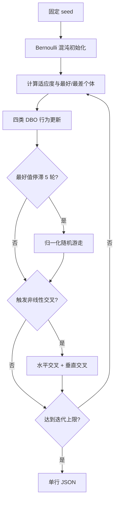

# 15 — RCDBO

来源论文：[Multi-strategy cooperative enhancement dung beetle optimizer and its application in obstacle avoidance navigation](<../paper.pdf>)。

这是**NumPy 核心重建，非完整复现**。脚本重建论文 RCDBO 的三项关键增强：Bernoulli 混沌初始化、停滞后的随机游走，以及后期垂直/水平交叉；它在小型移位 Rastrigin 函数上验证执行链，而不声称复现论文的 MATLAB、CEC2021、地图或统计实验。

## 执行过程

1. 固定随机种子，按论文式（8）的 Bernoulli 映射产生初始种群。
2. 计算移位 Rastrigin 适应度并保存全局最好/最差个体。
3. 将种群分组，依次执行滚动、繁殖、觅食和偷窃四类 DBO 更新。
4. 对每个候选做边界裁剪和贪心保留，保证记录的最好值不退化。
5. 若最好值连续五轮未变，生成累计二值随机游走，并按局部搜索边界归一化。
6. 使用论文的非线性交叉概率，在后期对随机配对个体执行水平交叉。
7. 对当前最好个体的两个维度执行垂直交叉，再做贪心选择。
8. 输出收敛、边界、有限数值及各策略接受次数。



## 重建假设

- 用 10 维移位 Rastrigin 代替论文的完整 CEC 与导航地图，专注检验优化器数据流。
- 四类 DBO 个体使用固定比例分组；论文未给出的随机系数采用有界、确定性采样。
- 代理域含负坐标，繁殖与觅食局部区间先逐维排序乘法端点，避免上下界因负最优坐标反转。
- 随机游走边界按论文分段缩放思想实现，并将累计轨迹归一化到当前个体附近。
- 交叉条件按论文文字含义实现为“随机数大于递减的跳过概率”，因此后期更常触发。
- 所有候选都裁剪到 `[-5.12, 5.12]`，只保留更优适应度。

## 运行

```bash
python3 run.py
```

## 输出

标准输出只有一行 JSON，顶层固定包含 `paper`、`algorithm`、`seed`、`metrics` 和 `checks`。`metrics` 给出初始/最终最好值、改进率、种群多样性及三类增强策略的触发/接受次数；`checks` 验证改进、最好值单调、边界和有限数值。
