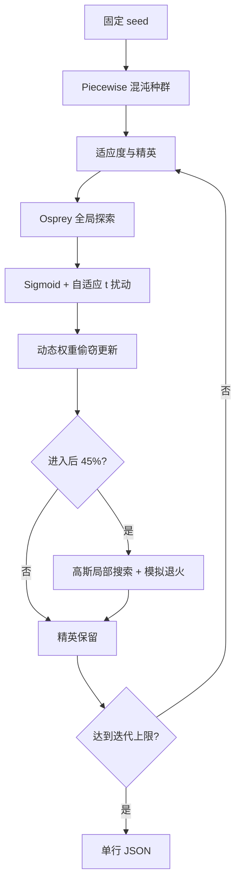

# 16 — MSDBO

来源论文：[Multi-strategy hybrid adaptive dung beetle optimization for UAV photogrammetric 3D path planning under complex constraints](<../paper.pdf>)。

这是**NumPy 核心重建，非完整复现**。脚本提取 MSDBO 的 Piecewise 混沌映射、Osprey 全局探索、自适应 t 分布、Sigmoid 收敛因子、动态权重与后期模拟退火，在一个小型多峰函数上实际执行这些计算；不包含原论文的 DEM/城市场景、CEC 数据、MATLAB 实现或多次统计实验。

## 执行过程

1. 固定种子，用论文式（15）的四段 Piecewise 映射初始化 12 维种群。
2. 计算移位 Rastrigin 适应度，记录当前最好、最差和全局最好。
3. 按式（16）执行 Osprey 风格的随机目标探测，扩大全局搜索。
4. 计算随进度变化的 Sigmoid 因子和自适应 t 分布扰动，围绕最好解搜索。
5. 按式（19）让 `k1` 递减、`k2` 递增，执行动态权重偷窃更新。
6. 从 55% 迭代处开始加入小尺度高斯扰动，并用 Metropolis 概率接受少量劣解。
7. 用精英保留恢复全局最好解，持续记录单调的 best-so-far 曲线。
8. 输出每种策略的接受次数、改进率以及数值安全检查。



## 重建假设

- 以 12 维移位 Rastrigin 作为可自包含的多峰代理问题，而非论文的完整 UAV/CEC 实验。
- 论文排版中的 t 分布自由度指数按归一化进度实现为 `exp(4*(t/T)^2)`，避免把未归一化迭代号代入指数导致数值溢出。
- Sigmoid 使用 `1/(1+exp(10*(t/T-0.5)))`，保留“前期自由度高、后期快速收缩”的含义。
- 模拟退火温度与高斯尺度采用小型实验所需的确定性退火表；接受规则仍为论文描述的 Metropolis 规则。
- 每轮末尾保留 best-so-far，因此即使退火接受劣解，报告的收敛曲线也不会回退。

## 运行

```bash
python3 run.py
```

## 输出

标准输出为单行 JSON，包含 `paper`、`algorithm`、`seed`、`metrics`、`checks`。其中 `metrics` 报告初始/最终最优值、改进率及五类更新的接受次数；`checks` 验证实际改进、精英曲线单调、边界有效和全部数值有限。
