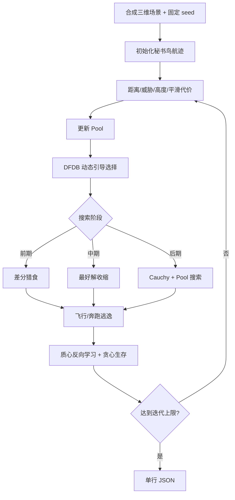

# 17 — MSBOA

来源论文：[Multi-strategy secretary bird optimization algorithm for UAV path planning in complex environment](<../paper.pdf>)。

这是**NumPy 核心重建，非完整复现**。脚本把论文的多策略秘书鸟优化器用于一个自包含的三维 UAV 航迹：四个控制点连接起终点，航迹代价由距离、圆柱威胁区、飞行高度和转向平滑度组成。它不复现论文的 DEM、CEC2017、八个原始场景或完整实验参数。

## 执行过程

1. 固定种子，生成四个控制点的 `y/z` 坐标；`x` 坐标按航程单调固定。
2. 按论文式（1）组合路径长度、威胁、飞行高度和平滑度代价。
3. 每轮用二进制掩码混合“最好邻域”和最差个体，更新 Pool。
4. 归一化适应度与到最好解的距离，按动态权重计算 DFDB 得分并选引导个体。
5. 前、中、后三阶段分别执行差分搜索、最好解收缩和 Cauchy/Pool 优先搜索。
6. 执行 Pool 辅助飞行或随机奔跑两种逃逸更新，并对候选做贪心保留。
7. 随机选择前 `K` 个体求质心，生成质心反向解，从合并的 `2N` 个体中保留最好 `N` 个。
8. 输出最终航迹的各项成本、碰撞段数、策略计数和一致性检查。



## 重建假设

- 采用两个圆柱威胁区和固定 `x` 站位的小型三维场景，决策向量仅含四个控制点的 `y/z`。
- 论文用无穷大表示硬碰撞；脚本改用有限的逐碰撞固定罚项与平方穿透罚项，以保证所有计算和 JSON 数值可检查且有限。
- 高度限制由变量边界保证；高度成本以巡航中值 2.2 为中心，权重沿用论文对高度项的强调。
- Pool 的“最好邻域上下界”在论文未给出具体宽度，因此取各维搜索跨度的 20%。
- DFDB 对最小化问题把较低成本归一化为较高得分，距离项仍奖励与当前最好解保持差异。
- 所有候选都裁剪到允许飞行范围，选择与质心反向学习均为严格贪心。

## 运行

```bash
python3 run.py
```

## 输出

标准输出只有一行 JSON。`metrics` 包含初始/最终综合成本、最终路径长度、威胁/高度/平滑成本、碰撞段数，以及 Pool/DFDB/猎食/逃逸/质心反向机制的计数；`checks` 验证改进、无碰撞、best-so-far 单调、边界和有限数值。
