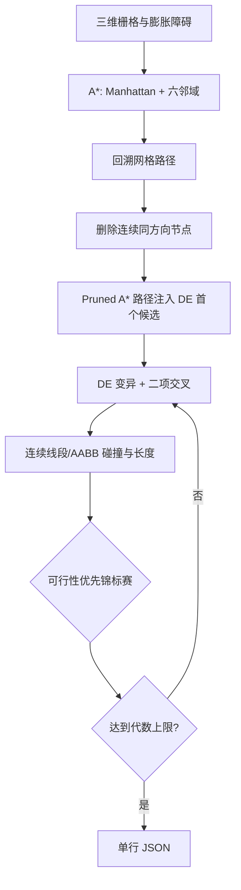

# 18 — Pruned A* + 元启发式

来源论文：[Optimized Path-Planning in Continuous Spaces for Unmanned Aerial Vehicles Using Meta-Heuristics](<../paper.pdf>)。

这是**NumPy 核心重建，非完整复现**。脚本重建论文最关键的组合执行链：在六邻域三维网格上用 A* 找到可行航迹，删除连续同方向节点，再把该路径作为连续空间差分进化（DE）的首个候选；DE 按可行性优先规则优化控制点。它不使用论文的 Unity 场景、OBB/SAT 完整几何、Parrot ANAFI 模型或 30 次统计实验。

## 执行过程

1. 建立 `20×16×6` 三维网格、起终点和两个贯穿高度的箱形墙体，并按 UAV 半径膨胀障碍。
2. 使用 Manhattan 启发式和上/下/前/后/左/右六邻域运行 A*。
3. 回溯网格路径，删除所有与前一步方向相同的连续中间节点，得到 Pruned A* 控制点。
4. 把剪枝路径作为 DE 种群的第一个精确可行解，其余为随机或邻域随机候选。
5. 以 `DE/rand/1/bin` 生成变异与交叉后的连续三维控制点。
6. 对每条线段执行 UAV 膨胀 AABB 的 slab 相交检测，并计算完整欧氏路径长度。
7. 按论文规则选择：可行优于不可行；可行路径中短者优先；不可行路径中碰撞少者优先。
8. 输出 A* 剪枝量、DE 评估/接受次数、长度变化、碰撞数和安全检查。



## 重建假设

- 使用两个轴对齐箱体近似论文的 OBB；碰撞检测为精确线段/AABB slab 测试，障碍预先按 UAV 半径 0.35 膨胀。
- 网格单元边长取 1，A* 禁止对角移动，与论文的六方向限制一致。
- 连续 DE 的控制点数量完全由 Pruned A* 决定，起点和终点不参与优化。
- 除一个精确 A* 种子外加入少量其邻域随机候选，以便小规模确定性实验能观察连续路径缩短；其余候选覆盖整个工作空间。
- 约束选择不使用罚函数：可行性和长度分开比较；碰撞数相同的不可行路径随机决胜。
- 这里使用 DE 代表论文比较的 DE/GA/PSO 元启发式分支，不等同于三者全部复现。

## 运行

```bash
python3 run.py
```

## 输出

标准输出是一行 JSON。`metrics` 报告原始/剪枝节点数、控制点数、A* 种子与连续优化后的长度、可行候选和 DE 接受计数；`checks` 验证找到并剪短节点序列、种子与最终路径无碰撞、种子未丢失、工作空间边界及有限数值。
