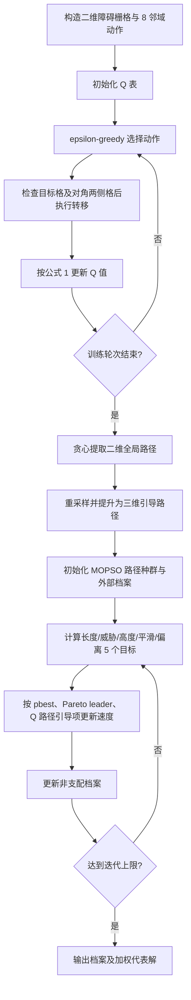

# QL-MOPSO：Q-learning 引导的多目标粒子群

来源论文：`Reinforcement Learning-Guided Particle Swarm Optimization.pdf`

这是依据论文第 2.1–2.3 节、公式 (1)–(7) 及 Algorithm 1–2 提取的 **NumPy 核心重建**，不是论文完整复现。论文地图、DEM 与原始实验数据未随 PDF 提供，因此使用固定的小型栅格、合成威胁与固定高度。

## 从论文提取的执行步骤

1. 将二维地图离散为自由格、障碍格与 8 个对称动作；对角动作要求相邻两个正交格也均可通行。
2. 以目标奖励、碰撞及角穿惩罚和步进代价训练 Q 表，按公式 (1) 更新状态动作价值。
3. 从起点按最大 Q 值贪心取样，逐步复用同一合法转移检查，生成无环且不穿障碍角的二维引导路径。
4. 重采样路径节点，并按 Algorithm 1 提升为固定高度的三维引导路径。
5. 在引导路径周围初始化 MOPSO 粒子，计算长度、威胁、高度、平滑度和偏离度。
6. 维护非支配外部档案，并从档案选择 leader。
7. 用惯性、个体最优、leader 和 Q 路径引导四项更新速度与位置。
8. 迭代至上限，输出 Pareto 档案和一个加权代表解。

## 逐步执行图



## 重建假设

1. 论文 Q-learning 参数采用表 1 附近的量级，合成示例使用 `alpha=0.15`、`gamma=0.95`。
2. Algorithm 1 的随机地形简化为固定飞行高度；威胁用两个球体表示。
3. MOPSO 保留论文新增的 Q 路径引导速度项和路径偏离目标；档案过大时用固定加权值截断。
4. 八邻域对角移动采用保守的“禁止夹角穿越”规则：目标格和与其共享边的两个正交邻格必须全部为空；数值仅证明执行链路和不变量，不能与论文表格直接比较。

## 运行

```bash
python3 run.py
```

标准输出是单个 JSON，其中 `metrics` 给出 Q 路径长度、对角步数、Pareto 档案规模、个人最优更新次数和优化前后代价；`checks` 逐步复核目标格、邻接步长及对角两侧障碍格，验证路径不碰撞、不角穿、抵达目标、引导种子不丢失、搜索确有严格改进更新与数值有限性。
