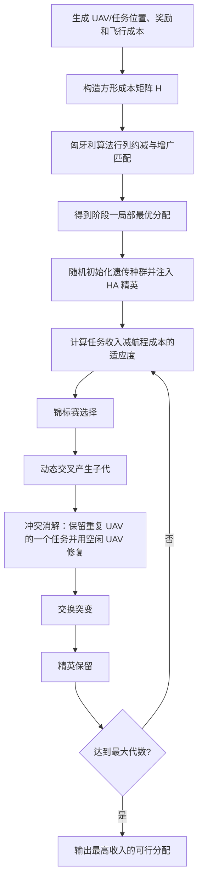

# TGALS：匈牙利启发式 + 冲突消解遗传搜索

来源论文：`Two-stage heuristic genetic optimization algorithm for multi-UAV .pdf`

这是依据论文第 3.1–3.3 节、公式 (6)–(7)、图 6/8 与 Algorithm 1 提取的 **NumPy 核心重建**，不是论文城市物流实验的完整复现。原始郑州三维场景与 RRT 航迹数据未提供，因此使用确定性生成的 UAV、取货点与交付点。

## 从论文提取的执行步骤

1. 根据 UAV→取货点→交付点的航程和任务奖励建立成本/收益矩阵。
2. 按论文第一阶段用匈牙利增广匹配求局部最优分配。
3. 随机初始化染色体种群，将匈牙利解注入为精英个体。
4. 计算每个染色体的总任务收益与路径耦合代价。
5. 通过锦标赛选择父代，以 `cr=0.8` 执行动态交叉。
6. 对同一 UAV 重复承担任务的子代执行空闲 UAV 冲突修复。
7. 以 `mu=0.2` 执行交换变异，并保留当代最优个体。
8. 迭代 100 代，输出收益最高且每任务唯一分配的解。

## 逐步执行图



## 重建假设

1. 演示采用 `N=M=8`，因此使用论文的“一 UAV 一任务”冲突修复分支。
2. 飞行成本用 UAV→取货点→交付点的欧氏距离近似论文中的 RRT 航迹成本。
3. 为使第二阶段不是退化的线性指派，加入很小的相邻分配路径耦合项；它代表论文强调的实际路径耦合，但不宣称复刻原始数据。
4. 遗传参数采用论文实验值 `cr=0.8`、`mu=0.2`、`maxGen=100` 的结构，种群缩小为 80。

## 运行

```bash
python3 run.py
```

输出 JSON 给出匈牙利种子、随机初始种群和最终收入，以及冲突修复次数；`checks` 验证分配唯一、精英不退化且数值有限。
