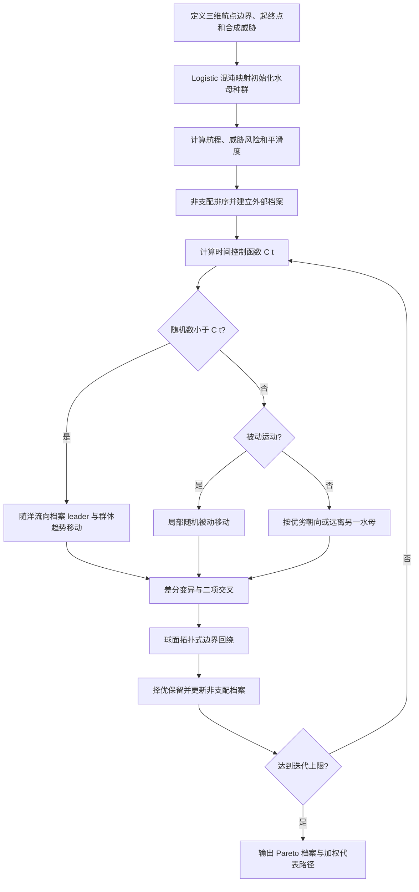

# PVDE-MOJS：并行向量化差分进化水母搜索

来源论文：`UAV Path Planning for Forest Firefighting Using Optimized Multi-Objective Jellyfish Search Algorithm.pdf`

这是依据论文第 3–4 节、公式 (12)–(36) 与图 5 提取的 **NumPy 核心重建**，不是论文完整复现。论文的真实 DEM、火场数据及并行基准未提供；这里运行同一搜索逻辑的确定性串行 CPU 版本。

## 从论文提取的执行步骤

1. 以三维航点向量表示 UAV 路径，定义边界、起终点和威胁区。
2. 按公式 (12)–(14) 使用 Logistic 混沌映射初始化水母种群。
3. 计算航程、威胁风险和平滑度三个目标，建立非支配档案。
4. 每代计算时间控制函数，在随洋流、被动和主动水母运动之间切换。
5. 从种群取三个个体完成差分变异，再做二项交叉。
6. 使用球面拓扑式回绕修复越界维度。
7. 仅接受 Pareto 支配或加权代价更低的候选；档案先去除重复决策向量，再以拥挤度截断。
8. 迭代至上限，输出非支配档案和加权代表路径。

## 逐步执行图



## 重建假设

1. 用 6 个内部三维航点表示路径，以三个合成球形威胁代替原始森林 DEM。
2. 保留 Logistic 初始化、MOJS 三种行为、时间控制、PVDE 差分变异和 Pareto 档案。
3. 论文的多核/Numba 加速不改变数值核心，故本例使用纯 NumPy 串行运算。
4. 三目标经过简化归一化；结果不能与论文 UF 测试或森林案例数值直接比较。

## 运行

```bash
python3 run.py
```

输出 JSON 给出 Pareto 档案规模、三种水母行为次数、优化前后加权代价及三个目标；`checks` 验证档案非支配且位置唯一、确有改进和数值有限。
