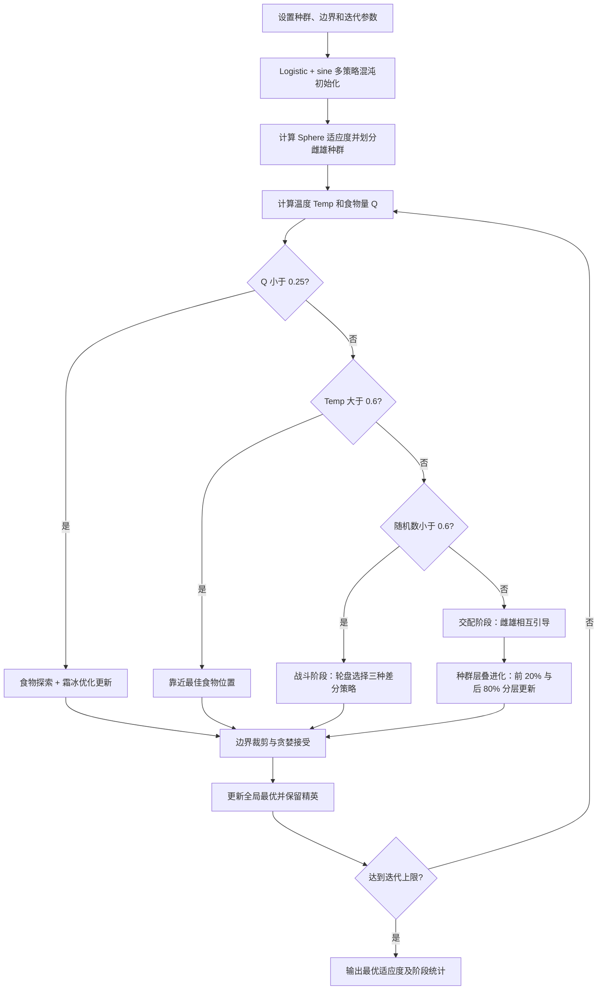

# AMISO：自适应多策略改进蛇优化算法

来源论文：`基于自适应多策略改进蛇优化算法的多无人机路径规划方法_王凯.pdf`

这是依据论文公式 (22)–(51) 与图 2 提取的 **NumPy 核心重建**，不是论文多无人机地图实验的完整复现。为隔离算法更新是否有效，运行论文表 1 的 Sphere 基准函数，而不是缺失的地形与威胁数据。

## 从论文提取的执行步骤

1. 用 Logistic 与 sine 复合混沌映射生成初始蛇群，并缩放到搜索边界。
2. 计算 Sphere 适应度，记录最佳食物位置，将种群均分为雌、雄两组。
3. 按公式 (24)–(25) 计算温度 `Temp` 和食物量 `Q`。
4. `Q<0.25` 时执行食物探索，并按公式 (43)–(46) 注入霜冰优化。
5. 食物充足且温度较高时，使蛇群靠近当前最佳食物。
6. 低温战斗时根据成功计数轮盘选择公式 (39)–(41) 的三种差分策略。
7. 交配时让雌雄最优个体相互引导，再按公式 (47)–(51) 对前 20%/后 80% 分层进化。
8. 执行边界修复、贪心接受和精英保留，直至迭代结束。

## 逐步执行图



## 重建假设

1. 混沌公式 (36) 的正弦输出先线性映射至 `[0,1]`，保证初始化满足边界。
2. 原 SO 的探索/靠近食物步骤保留其相对个体和食物位置的更新结构；论文新增的霜冰、轮盘策略池和层叠进化均实际执行。
3. 使用显式精英保留，避免数值演示因随机更新丢失已找到的最优解。
4. `initial_to_final_ratio` 明确定义为 `initial_best / final_best`，大于 1 表示最终值更小；它是初末倍率而不是相对改善百分比。Sphere 结果只验证数值管线，不代表论文无人机约束目标或表 2 数值的复现。

## 运行

```bash
python3 run.py
```

输出 JSON 包含初末最优值、明确命名的初始值/最终值倍率 `initial_to_final_ratio`、各搜索阶段次数和三种轮盘策略调用量；`checks` 验证改进、边界和有限数值。
